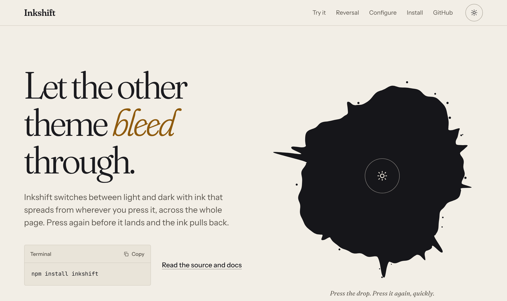
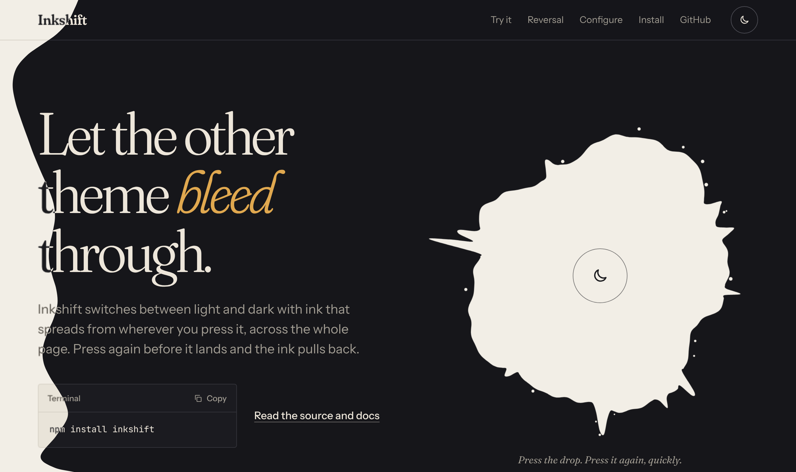

<picture>
  <source media="(prefers-color-scheme: dark)" srcset=".github/assets/demo-dark.png">
  
</picture>

# Inkshift

**An organic ink-bleed transition between light and dark themes.**

When someone presses your theme toggle, an irregular ink splat grows from the exact point they pressed and reveals the new theme across the whole page: sticky headers, backgrounds and images included. Press again before the ink lands and it pulls back, restoring the original theme.

It is not a circular ripple. Each splat is generated from a seeded noise outline with long and short tendrils and satellite droplets, and two splats spread together so the edge keeps changing shape as it soaks outward.

- **Framework-independent core** with a separate **React** entry point
- **Reversible**: a second press turns the same animation around; rapid presses never start competing transitions
- **Light, dark and system** preferences, persisted, synced across tabs, following OS changes live
- **No flash on load**: a tiny inline script sets the theme before first paint
- **Accessible**: a real button with a clear label, keyboard origin at the button's centre, and `prefers-reduced-motion` switches instantly
- **Graceful fallbacks**: colour cross-fade without View Transitions, instant with reduced motion
- **No runtime dependencies**; about 5 kB gzipped ([measured](#bundle-size))

> **Status:** 0.1.0, not yet published to npm. Until the first release, install from a local build (see [Contributing](CONTRIBUTING.md)).

<p align="center">
  
</p>

## Contents

- [Install](#install) · [Quick start](#quick-start) · [React](#react) · [Without a framework](#without-a-framework)
- [Options](#options) · [Styling](#styling) · [First paint](#first-paint) · [Reduced motion](#reduced-motion)
- [Browser support](#browser-support) · [Bundle size](#bundle-size) · [How it works](#how-it-works)
- Full docs: [API](docs/api.md) · [Customization](docs/customization.md) · [Browser support](docs/browser-support.md) · [Architecture](docs/architecture.md)

## Install

```bash
npm install inkshift
```

React 18 or later is an optional peer dependency, needed only for `inkshift/react`.

## Quick start

```tsx
import { ThemeProvider, ThemeToggle } from 'inkshift/react';
import 'inkshift/styles.css';

export function App() {
  return (
    <ThemeProvider defaultTheme="system" storageKey="my-app-theme">
      <ThemeToggle />
    </ThemeProvider>
  );
}
```

Then add the [first-paint script](#first-paint) to your HTML so the right theme is applied before React mounts.

Style your page from the theme attribute (or use the bundled [tokens](#styling)):

```css
:root { --bg: #f2eee6; --fg: #16161a; }
:root[data-theme='dark'] { --bg: #16161a; --fg: #f2eee6; }
body { background: var(--bg); color: var(--fg); }
```

## React

```tsx
import { ThemeProvider, ThemeToggle, useTheme } from 'inkshift/react';

<ThemeProvider
  defaultTheme="system"
  storageKey="my-app-theme"
  animation={{ type: 'ink', duration: 1100 }}
>
  <ThemeToggle />
</ThemeProvider>;

function Status() {
  const { theme, resolvedTheme, systemTheme, setTheme, toggleTheme, isTransitioning } = useTheme();
  // theme: 'light' | 'dark' | 'system'   resolvedTheme: 'light' | 'dark'
}
```

A custom toggle passes its click event (or a point) as the origin:

```tsx
const { toggleTheme } = useTheme();

<button onClick={(event) => toggleTheme(event)}>Toggle theme</button>
// or: toggleTheme({ x: event.clientX, y: event.clientY })
```

Passing the event is best: a pointer press bleeds from the pointer, a keyboard press from the centre of the button.

| Export | What it is |
| --- | --- |
| `ThemeProvider` | Owns one theme controller. Takes every [option](#options) as a prop. |
| `useTheme()` | `{ theme, resolvedTheme, systemTheme, isTransitioning, setTheme, toggleTheme }` |
| `ThemeToggle` | Accessible `<button>` with sun/moon icons. Accepts button props, `labels`, `ref`, custom children. |
| `ThemeScript` | Renders the first-paint `<script>` for server-rendered apps (Next.js, Remix, Astro). |

## Without a framework

```ts
import { createThemeController } from 'inkshift';
import 'inkshift/styles.css';

const theme = createThemeController({
  storageKey: 'my-app-theme',
  defaultTheme: 'system',
});

button.addEventListener('click', (event) => theme.toggleTheme(event));

theme.setTheme('dark');               // animate from the viewport centre
theme.toggleTheme({ x: 300, y: 200 }); // from a point, in viewport CSS pixels
theme.subscribe(() => console.log(theme.getState()));
```

The controller follows the system theme, syncs across tabs, and keeps `<html data-theme>` as the single source of truth. Call `theme.destroy()` to remove its listeners.

## Options

Shared by `createThemeController(options)` and `<ThemeProvider {...options}>`.

| Option | Default | |
| --- | --- | --- |
| `storageKey` | `'inkshift-theme'` | localStorage key for an explicit choice |
| `defaultTheme` | `'system'` | `'light'`, `'dark'` or `'system'` when nothing is stored |
| `attribute` | `'data-theme'` | Attribute on the target holding the theme; `'class'` toggles `.light` / `.dark` |
| `target` | `<html>` | Element that carries the theme |
| `themeColor` | `{ light: '#f2eee6', dark: '#16161a' }` | Written to `<meta name="theme-color">`; `false` leaves it alone |
| `persist` | `true` | Store explicit choices |
| `followSystem` | `true` | Follow OS changes while the preference is `system` |
| `respectReducedMotion` | `true` | Switch instantly under `prefers-reduced-motion: reduce` |
| `animation.type` | `'ink'` | `'ink'`, `'fade'` or `'instant'` |
| `animation.duration` | `1100` (ink), `450` (fade) | Milliseconds |
| `animation.seed` | random | Seed for reproducible splats; each ink run uses the next two |
| `onThemeChange` | | `(state) => void` |
| `onTransitionStart` | | `({ from, to, type }) => void` |
| `onTransitionEnd` | | `({ from, to, type, theme, reversed }) => void` |

The defaults reproduce the original animation exactly. Details in [docs/api.md](docs/api.md).

## Styling

```js
import 'inkshift/styles.css';      // tokens + transitions
// or pick:
import 'inkshift/transitions.css'; // required rules for the transition and the toggle
import 'inkshift/tokens.css';      // optional palette (warm paper, deep charcoal)
```

`transitions.css` is scoped to classes Inkshift sets on `<html>` only while a switch is happening (`inkshift-transition`, `inkshift-switching`, `inkshift-fade`) and to `.inkshift-toggle`. The tokens are zero-specificity (`:where()`), so any rule of yours wins:

```css
:root { --inkshift-background: #fdfcf9; --inkshift-foreground: #1d1d1f; }
:root[data-theme='dark'] { --inkshift-background: #0f1115; --inkshift-foreground: #e9e6df; }
```

More in [docs/customization.md](docs/customization.md).

## First paint

Put the init script in `<head>`, before your stylesheets. It reads the stored preference, falls back to `prefers-color-scheme`, sets `data-theme` and `theme-color`, and survives storage errors. Generate it with the same options as your controller:

```ts
import { createInitScript } from 'inkshift';

const html = `<script>${createInitScript({ storageKey: 'my-app-theme' })}</script>`;
```

- **Server-rendered React:** render `<ThemeScript storageKey="my-app-theme" />` in `<head>`.
- **Vite:** inject it with `transformIndexHtml` (the [demo's config](demo/vite.config.ts) does exactly this).
- **Static HTML:** paste the output of `createInitScript()` into a `<script>` tag.

## Reduced motion

With `prefers-reduced-motion: reduce`, the switch is instant: no ink, no fade, not a shortened animation. The theme still changes and is still stored. Set `respectReducedMotion: false` only if your app offers its own motion setting.

## Browser support

Inkshift detects features, not browsers:

| The browser has | What happens |
| --- | --- |
| View Transitions API, Web Animations on pseudo-elements, CSS masks | The ink bleed |
| Anything less | A colour cross-fade (450 ms) |
| `prefers-reduced-motion: reduce` | An instant switch |

It also copes with unavailable `localStorage`, missing `matchMedia`, images that fail to decode, rapid repeated presses, and a tab hidden mid-animation. No path leaves the page between themes. The browser test suite runs in Chromium; see [docs/browser-support.md](docs/browser-support.md).

## Bundle size

Measured with `npm run size` (each entry bundled from `dist/` and minified, React external):

| Import | Minified | gzip | brotli |
| --- | --- | --- | --- |
| `inkshift` (everything) | 14.32 kB | 5.22 kB | 4.67 kB |
| `createThemeController` only | 13.29 kB | 4.90 kB | 4.40 kB |
| `inkshift/react` (everything) | 17.45 kB | 6.35 kB | 5.67 kB |
| `inkshift/styles.css` (unminified) | 4.99 kB | 1.74 kB | 1.42 kB |

## How it works

1. The press is turned into a viewport point: the pointer, the centre of the control for keyboard presses, or a point you pass.
2. `document.startViewTransition` snapshots the page. Inside its update, the theme is applied with CSS transitions off, Inkshift waits one task for frameworks to render, and briefly (up to 250 ms) for images in view to decode.
3. Two splats are generated: 240 angular samples of a seeded (Mulberry32) outline made of eight waves, with 10–15 tendrils, smoothed by a closed Catmull-Rom spline into cubic Béziers, plus 8–15 droplets, as an SVG mask.
4. A Web Animation grows both masks on `::view-transition-new(root)` from the point until each splat's innermost edge is 4 px past the farthest corner, with 6% headroom. The second splat trails the first, so the outline evolves.
5. A second press reverses that same animation in place. When it has pulled all the way back, the live page is switched back to the old theme under the old snapshot, so the end is invisible.

[docs/architecture.md](docs/architecture.md) covers the details, including the edge cases.

## Demo

The demo lives in [`demo/`](demo) and runs the library from source: `npm install && npm run dev`. To publish it, enable GitHub Pages with **GitHub Actions** as the source; [`.github/workflows/pages.yml`](.github/workflows/pages.yml) deploys it on every push to `main`.

## Contributing

See [CONTRIBUTING.md](CONTRIBUTING.md). `npm run check` runs type checking, linting, unit tests, the build and the browser tests.

## Origin

Inkshift is extracted from the theme switch of [lloydaq/lloyd-portfolio](https://github.com/lloydaq/lloyd-portfolio). The splat generator is byte-for-byte the original, and a parity test keeps it that way.

## License

[MIT](LICENSE) © Lloyd D’Souza
